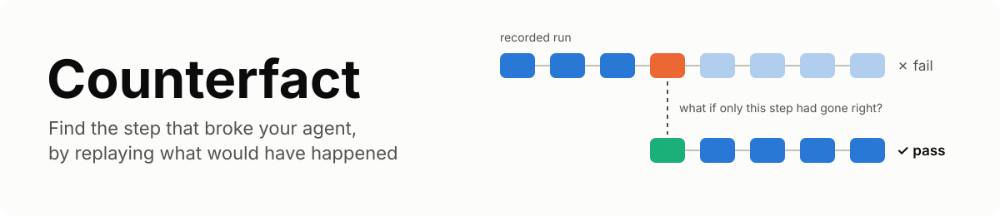
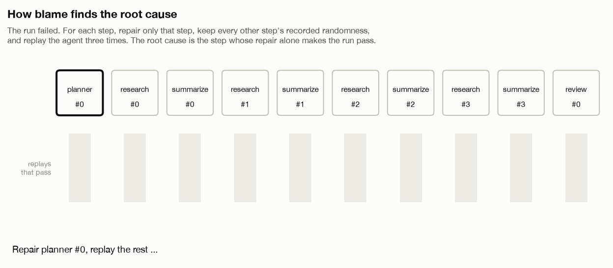
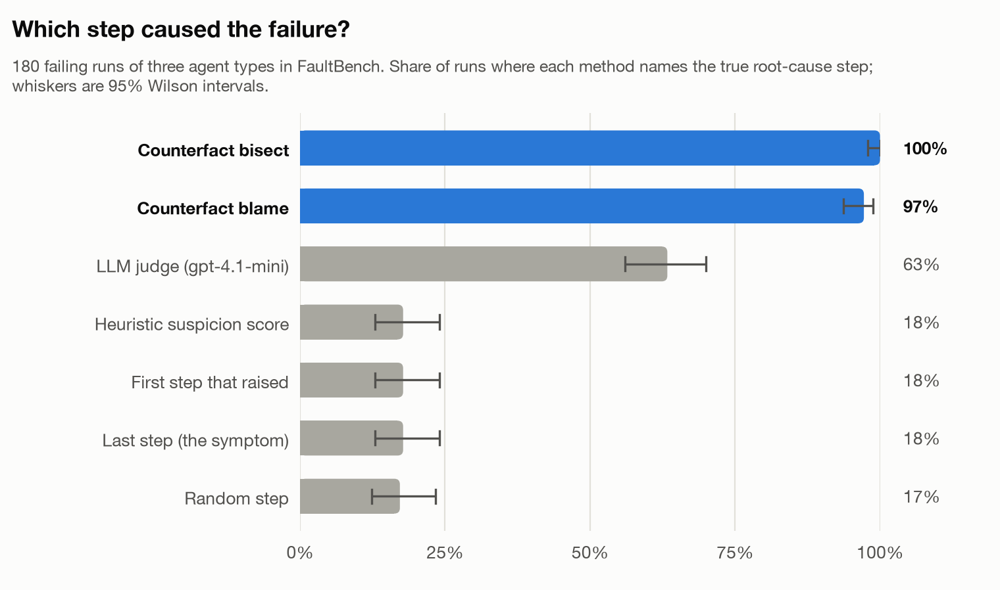
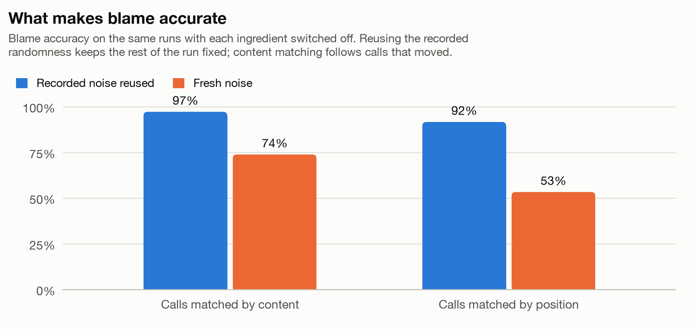
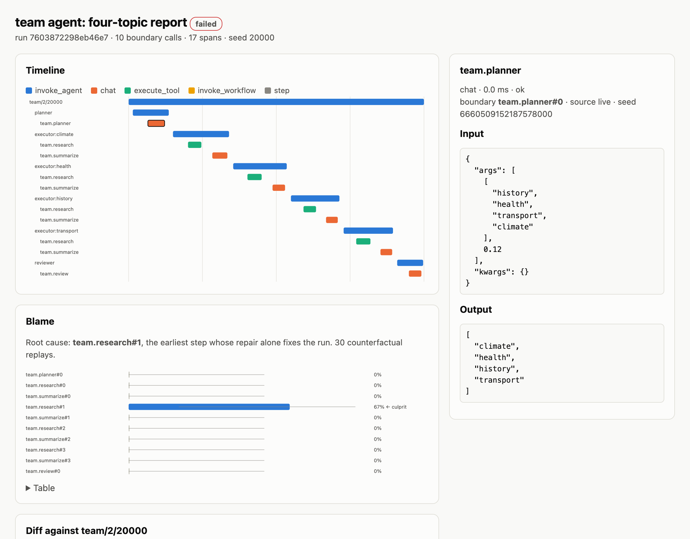

<picture>
  <source media="(prefers-color-scheme: dark)" srcset="docs/assets/banner-dark.svg">
  
</picture>

**Counterfact records an LLM agent run and tells you which step caused it to fail.**

A trace shows what happened. It doesn't show what *caused* the failure, and the step where
the failure surfaces (usually the last one) is rarely the step where it started. Counterfact
answers the causal question directly. For each step it asks: *if only this step had gone
right, and everything else had happened exactly as it did, would the run have passed?* It
answers by replaying the agent with that one step repaired.

On FaultBench, 180 failing runs with known root causes, this finds the culprit in
**97%** of runs (95% CI 94–99%). Picking the first error or the last step finds it in 18%.

<picture>
  <source media="(prefers-color-scheme: dark)" srcset="docs/assets/blame-dark.gif">
  
</picture>

## What you get

- **Record and replay.** Wrap tools and model calls as *boundaries*, or capture every
  model API call made through an httpx-based SDK (current OpenAI and Anthropic SDKs
  included) with one line. A recorded run replays exactly, offline, with no API keys.
- **Blame.** Find the earliest step whose repair alone makes the run pass, with a
  confidence interval for every step.
- **Bisect.** Given a failing and a passing run of the same task, binary-search for the
  step where they part ways. This needs no repair at all.
- **Diff.** Align two runs call by call, even when steps were added, removed or moved.
- **Report.** A single HTML file with the timeline, blame bars, run diff and a span
  inspector. It works offline, in light or dark mode.
- **Agent tests.** pytest fixtures that record a tape once and replay it in CI, plus
  contract assertions: allowed tools, call budgets, call order, no secrets in prompts.
- **OpenTelemetry.** Export runs as OTLP using the GenAI semantic conventions, or import
  OTLP traces for viewing and diffing.
- **A store that stays small.** The content-addressed SQLite store keeps each repeated
  prompt prefix once. It redacts keys, tokens, emails, phone numbers and card numbers
  before a run is written.

## Quickstart

```bash
uv add "counterfact @ git+https://github.com/Sanika0212/Counterfact"
uv run counterfact demo        # finds the culprit in a built-in failing agent, writes report.html
```

The same idea in code, from [`examples/quickstart.py`](examples/quickstart.py):

```python
import counterfact.runtime as cf
from counterfact.attribution import blame
from counterfact.model import SpanKind
from counterfact.report import write_report

PRICES = {"apple": 3, "pear": 5, "plum": 7}

@cf.boundary
def lookup(item: str) -> int:
    """A tool that is usually right. All of its randomness comes from cf.rng()."""
    price = PRICES[item]
    return price + 10 if cf.rng().random() < 0.15 else price

@cf.boundary(kind=SpanKind.CHAT)
def answer(prices: list[int]) -> str:
    return f"The basket costs ${sum(prices)}."

def agent() -> str:
    return answer([lookup(item) for item in PRICES])

def check(outcome: str) -> bool:
    return outcome == "The basket costs $15."

runs = (cf.execute(agent, seed=seed, check=check, name="basket") for seed in range(100))
failing = next(run for run in runs if not run.passed)   # 'The basket costs $25.'

report = blame(agent, failing, check)
print(report.culprit.key)                                # lookup#0, after 3 replays
write_report(failing, "quickstart-report.html", blame=report)
```

## How it works

Counterfact follows the three-step recipe for counterfactuals from causal inference:
abduction, action and prediction.

1. **Record (abduction).** Every boundary call gets a stable key, such as `research#1`
   for the second call to `research`, and its own random seed. Randomness inside a
   boundary comes from `cf.rng()`, so the recording pins down the "noise" that made this
   run turn out the way it did.
2. **Intervene (action).** A plan changes one step. `Resample` re-runs the step with
   fresh noise; `Replace` makes it return a given value. Every other step keeps its
   recorded noise.
3. **Replay (prediction).** The agent runs again. Calls with unchanged inputs are served
   from the recording. Calls whose inputs changed, because they sit downstream of the
   intervention, run live with their recorded noise. The outcome check then says whether
   the repaired run passes.

`blame` repeats this for each step, earliest first. It stops at the first step whose
repair makes at least half of the replays pass. `bisect` splices the failing and passing
recordings together at a cut point and binary-searches the cut. That takes two sanity
replays plus about log₂(steps), and no repair function.

Two details matter, and the ablation below measures both:

- **Reuse the recorded noise.** Without it, every re-executed step draws new noise, so a
  replay can pass or fail for reasons unrelated to the step being tested.
- **Match calls by content.** A repair can change control flow and move a call to a new
  position. Counterfact finds the call's recording by name and input fingerprint, not by
  position alone.

More detail is in [docs/how-it-works.md](docs/how-it-works.md).

## Results

FaultBench ([docs/faultbench.md](docs/faultbench.md)) has executable agents of three
kinds:

- a tool-using calculator;
- a planner/researcher/reviewer team;
- a retrieval QA pipeline.

Each step fails silently with probability 0.12: it returns a wrong value and raises
nothing. Correct steps vary harmlessly, as model outputs do. Each instance is a failing
run in which exactly one step went wrong. Ground truth comes from validators that check
every step against the inputs it received; the methods under test never see them.

<picture>
  <source media="(prefers-color-scheme: dark)" srcset="docs/assets/faultbench-dark.png">
  
</picture>

| Method | Accuracy (95% CI) | calc | rag | team | Replays per run |
|---|---|---|---|---|---|
| Random step | 17% [12%, 23%] | 15% | 27% | 10% | 0 |
| Last step (the symptom) | 18% [13%, 24%] | 15% | 32% | 7% | 0 |
| First step that raised | 18% [13%, 24%] | 15% | 32% | 7% | 0 |
| Heuristic suspicion score | 18% [13%, 24%] | 15% | 32% | 7% | 0 |
| **Counterfact blame** | **97% [94%, 99%]** | 95% | 98% | 98% | 7.3 |
| **Counterfact bisect** | **100% [98%, 100%]** | 100% | 100% | 100% | 4.7 |

The faults are silent, so "first step that raised" and the suspicion heuristic have no
error to go on and fall back to the last step. That is exactly why silent failures are
hard to debug from a trace.

There is also an LLM-judge baseline, in which a model reads the full trace and names the
culprit; it's implemented in [`judge.py`](src/counterfact/judge.py). Its results will be
added here once it has been run. To run it yourself, see
[Configuring the LLM judge](#configuring-the-llm-judge).

<picture>
  <source media="(prefers-color-scheme: dark)" srcset="docs/assets/ablation-dark.png">
  
</picture>

| Blame variant | Accuracy (95% CI) |
|---|---|
| Content matching, recorded noise reused (default) | 97% [94%, 99%] |
| Positional matching, recorded noise reused | 92% [87%, 95%] |
| Content matching, fresh noise | 74% [67%, 80%] |
| Positional matching, fresh noise | 53% [46%, 60%] |

To reproduce both tables (a few minutes on a laptop):

```bash
uv run counterfact bench --per-family 60 --methods last first_error random suspicion \
  blame bisect blame_position blame_fresh_noise blame_position_fresh_noise
```

## Recording real LLM agents

`counterfact.http.instrument()` wraps `send` on the `httpx` and `httpx2` clients, which
current OpenAI and Anthropic SDKs use. Every request made inside a run becomes a
boundary named after the provider and operation, such as `openai.chat#0`. Streaming
responses are buffered while recording, so they replay byte for byte.

```python
import openai
import counterfact.runtime as cf
from counterfact import http

http.instrument()
client = openai.OpenAI()

def agent() -> str:
    reply = client.chat.completions.create(
        model="gpt-4.1-mini", messages=[{"role": "user", "content": "Refund window?"}]
    )
    return reply.choices[0].message.content

run = cf.execute(agent, name="support-bot", check=lambda text: "30 days" in text)

# Replay offline: no network, same bytes, same outcome.
replay = cf.execute(agent, plan=cf.Plan.replay(run.tape(), strict=True))

# What if the first model call had answered differently?
what_if = cf.Plan.counterfactual(
    run.tape(), {"openai.chat#0": cf.Replace(http.chat_reply("Refunds are accepted for 30 days."))}
)
print(cf.execute(agent, plan=what_if, check=lambda text: "30 days" in text).passed)
```

## Testing agents with pytest

The plugin loads automatically once Counterfact is installed.

```python
from counterfact.testing import assert_max_calls, assert_no_secrets, assert_tools_within

def test_support_bot(cf_tape):
    run = cf_tape(agent, "support-bot", check=lambda text: "30 days" in text)
    assert run.passed
    assert_tools_within(run, {"search_orders", "refund_policy"})
    assert_max_calls(run, 4)          # model calls per run
    assert_no_secrets(run)
```

The first run records `tests/tapes/support-bot.tape.json`. Later runs replay that tape
strictly and offline. If the agent's calls change, the run stops with a `Divergence`
error. Pass `--counterfact-record` to re-record, or `--counterfact-db runs.sqlite` to keep
every run for `counterfact report`.

Tapes store exact request and response bytes so they can replay; they aren't redacted.
Use `assert_no_secrets` to keep credentials and personal data out of them.

## Command line

| Command | What it does |
|---|---|
| `counterfact demo` | Find the culprit in a built-in failing agent and write a report |
| `counterfact runs` / `show RUN` | List stored runs / print a run's span tree |
| `counterfact report RUN [--compare RUN]` | Write the single-file HTML report |
| `counterfact diff LEFT RIGHT` | Align two runs and print where they diverge |
| `counterfact blame --run RUN --agent mod:fn --check mod:fn` | Root-cause a stored failing run |
| `counterfact bisect --fail RUN --pass RUN --agent ... --check ...` | Bisect a failing run against a passing one |
| `counterfact bench` | Run FaultBench |
| `counterfact export RUN [--endpoint URL]` | Write OTLP JSON, or post it to a collector |

<picture>
  <source media="(prefers-color-scheme: dark)" srcset="docs/assets/report-dark.png">
  
</picture>

## Configuring the LLM judge

The judge baseline calls a model API, so it needs a key. Keep the key in a `.env` file
at the repository root. The file is git-ignored; never commit a key or paste it into an
issue.

```bash
cp .env.example .env     # then set ONE of the keys in .env
chmod 600 .env
uv run counterfact bench --methods llm_judge     # adds the judge row to runs/faultbench
```

If both keys are set, `COUNTERFACT_JUDGE_PROVIDER` picks the provider.
`COUNTERFACT_JUDGE_MODEL` overrides the model. The test suite never calls a paid API.

## Limits

- **Blame needs a re-runnable agent.** You must be able to call the agent again with the
  same inputs, and its randomness must come from `cf.rng()` or recorded calls. Put side
  effects, such as sending an email, behind a boundary so that replays don't repeat them.
- **Hosted models don't expose their noise.** If a model call's inputs change during a
  counterfactual, the call is a fresh live sample. For those steps blame behaves like
  the fresh-noise ablation above. Expect lower accuracy, and raise `samples`.
- **The repair has to be possible.** The default repair resamples a step. A step that is
  wrong on every sample, such as one driven by a bad prompt, needs a `Replace` with a
  known-good value, or a `bisect` against a passing run.
- **FaultBench is synthetic.** Its ground truth is known by construction, and every run
  has exactly one fault. The numbers show the mechanism works; they don't measure
  accuracy on your agent.
- **The OpenTelemetry GenAI conventions are still in Development status.** Attribute
  names follow version 1.41 and may change.

## Development

```bash
git clone https://github.com/Sanika0212/Counterfact.git && cd Counterfact
uv sync --extra viz
uv run pytest --cov                                     # tests never touch the network
uv run counterfact bench --out runs/faultbench          # benchmark
uv run --extra viz python scripts/make_figures.py       # README figures
```

[CONTRIBUTING.md](CONTRIBUTING.md) lists the checks CI runs.

## References

- Judea Pearl. *Causality: Models, Reasoning, and Inference*, 2nd ed. Cambridge
  University Press, 2009. (Counterfactuals by abduction, action and prediction.)
- Andreas Zeller and Ralf Hildebrandt. Simplifying and isolating failure-inducing input.
  *IEEE Transactions on Software Engineering* 28(2), 2002. (Delta debugging, the idea
  behind `bisect`.)
- Shaokun Zhang et al. Which agent causes task failures and when? On automated failure
  attribution of LLM multi-agent systems. *ICML*, 2025. (Failure attribution by reading
  traces, the setting of the judge baseline.)
- Edwin B. Wilson. Probable inference, the law of succession, and statistical inference.
  *Journal of the American Statistical Association* 22(158), 1927. (Confidence intervals.)
- OpenTelemetry. Semantic conventions for generative AI systems.

## License

MIT © 2026 Sanika Najan. See [LICENSE](LICENSE).
